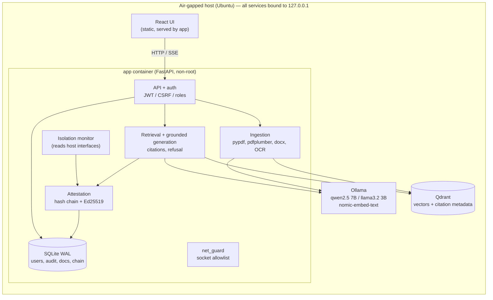

# Architecture

## Request flow: answering a question
1. The UI sends a `POST /api/chat`. The JWT and CSRF token are checked, and the rate limit applies.
2. The app embeds the question with `nomic-embed-text` via Ollama, then runs a top-k search in Qdrant.
3. If the best score is below the refusal threshold, the answer is "I don't know". The model is not called.
4. Otherwise the prompt is built. Chunks are inserted as delimited, untrusted data with chunk IDs, and the model is told to answer only from them and to cite the IDs.
5. The answer streams back over SSE.
6. A grounding check runs: every cited ID must be among the retrieved chunks, and the answer must cite at least one.
7. The attestation block is built from the hashes, citations, a fresh interface snapshot and the monitor state. It is signed and appended.
8. The UI shows the citations and offers "Verify this answer" (`GET /api/attestation/{index}/verify`).

## Deployment
Docker Compose runs `app`, `qdrant` and `ollama` with `network_mode: host`, each bound to 127.0.0.1. Host networking is needed so the monitor sees the real host interfaces; the reasoning is in `deploy/docker-compose.yml`. A systemd path without Docker comes in v1.0.0.

## Key decisions
| Decision | Reason |
|----------|--------|
| Host networking plus loopback binds | The monitor needs the host's interface view. No service listens on a non-loopback address. |
| In-process socket guard (`backend/app/net_guard.py`) | R1 is enforced in code, not only by the air gap. |
| Swagger/ReDoc disabled | Both pages load JavaScript from public CDNs (R1). |
| SQLite in WAL mode | One machine, 1–10 users; no extra server to run. |
| `llama3.2:3b` by default (RC1), `qwen2.5:7b` optional | Measured on the demo gold set, on an i5-12450H laptop with 16 GB and CPU only (`eval/results/20261011T*`). 3B: p95 34 s, first-token p50 13 s, citation accuracy 0.946, refusal recall 0.92. 7B: p95 63 s, first-token p50 29 s, citation accuracy 1.0, refusal recall 1.0. 7B is more accurate but exceeds the 60 s p95 budget, so 3B ships for RC1. 7B, or a GPU, is the candidate default for the semester-end review. The injection filter (PR #3) covers the probe that 3B failed (i02). |
| Answer speed: GPU, short answers, cached system prompts | NVIDIA driver 617.42 makes the RTX 2050 (4 GB) usable. `OLLAMA_FLASH_ATTENTION=1` with a `q8_0` KV cache and `OLLAMA_NUM_PARALLEL=1` keeps 3B 100% on the GPU: 45 tok/s, versus 32 tok/s when the model is split with the CPU. The prompts ask for 1-4 sentences (`num_predict` 320), `max_context_chars` is 6000, `chunk_tokens` is 400 (`python -m app.cli reindex`), and warm-up caches both system prompts. `OLLAMA_NO_CLOUD=1` stops Ollama contacting ollama.com. Demo gold set (`eval/results/20261013T080735Z-*`) against RC1 on the CPU: total p50 0.92 s / p95 1.67 s (was p95 33.4 s), first token p50 0.30 s (was 12 s), hit rate 1.0, citation accuracy 0.973 (was 0.972), refusal P/R 0.929/1.0 (was 0.867/1.0), keyword match 0.944 (was 0.971). CPU only on battery: about 6 tok/s; plug in for demos. |
